# 🎵 SMECONE MUSIC — Sistem Informasi & Manajemen Ekstrakurikuler

<p align="center">
  
</p>

<p align="center">
  <strong>Ekstrakurikuler Musik SMK Negeri 1 Purwokerto</strong><br>
  <em>"When the world falls, music speaks."</em>
</p>

<p align="center">
  
  
  
  
  
  
</p>

---

## 📌 Daftar Isi
1. [Tentang Proyek](#-tentang-proyek)
2. [Latar Belakang & Identifikasi Masalah](#-latar-belakang--identifikasi-masalah)
3. [Tujuan & Manfaat Sistem](#-tujuan--manfaat-sistem)
4. [Arsitektur & Skema Basis Data (12 Tabel)](#-arsitektur--skema-basis-data-12-tabel)
5. [📸 Dokumentasi Visual Aplikasi (Per Halaman Lengkap)](#-dokumentasi-visual-aplikasi-per-halaman-lengkap)
   - [A. Area Publik & Branding Sekolah](#a-area-publik--branding-sekolah)
   - [B. Autentikasi, Keamanan, & OTP](#b-autentikasi-keamanan--otp)
   - [C. Area Siswa / Anggota (User Dashboard)](#c-area-siswa--anggota-user-dashboard)
   - [D. Area Panel Administrator & Pengurus](#d-area-panel-administrator--pengurus)
6. [🛡️ Role-Based Access Control (RBAC) & Matriks Hak Akses](#️-role-based-access-control-rbac--matriks-hak-akses)
7. [🧪 Pengujian Kualitas Perangkat Lunak (Automated QA 100% Pass)](#-pengujian-kualitas-perangkat-lunak-automated-qa-100-pass)
8. [🚀 Panduan Instalasi & Menjalankan Proyek](#-panduan-instalasi--menjalankan-proyek)
9. [🔑 Kredensial Akun Default Demo](#-kredensial-akun-default-demo)

---

## 📖 Tentang Proyek
**Smecone Music Web Application** adalah platform digital komprehensif berbasis web yang dirancang khusus untuk memodernisasi tata kelola operasional, peminjaman instrumen inventaris sekolah, reservasi Studio Musik (STM), serta publikasi prestasi dan etalase karya ekstrakurikuler musik di **SMK Negeri 1 Purwokerto**.

Aplikasi ini mengintegrasikan antarmuka publik modern bernuansa *dark-mode* seni musik dengan sistem manajemen operasional berjenjang (*Role-Based Access Control*), verifikasi pendaftaran mandiri kode OTP via Google SMTP Gmail, pencegahan tabrakan jam latihan (*Conflict-Free Studio Scheduling*), serta integrasi verifikasi identitas siswa dengan tombol chat WhatsApp langsung.

---

## 🎯 Latar Belakang & Identifikasi Masalah

Sebelum sistem ini dibangun, operasional harian Smecone Music menghadapi beberapa tantangan nyata:
1. **Pencatatan Peminjaman Alat Masih Konvensional**: Peminjaman instrumen musik sekolah (gitar, bass, drum kit, amplifier, kabel jack) dicatat secara manual di buku tulis atau percakapan WhatsApp pribadi. Hal ini mengakibatkan data mudah tercecer, riwayat peminjam tidak terlacak, dan kondisi fisik alat sulit dipertanggungjawabkan oleh Seksi Perlengkapan (Perkap).
2. **Bentrok Jadwal Latihan Studio STM**: Ketiadaan kalender ketersediaan ruangan studio terpusat memicu seringnya terjadi tumpang tindih waktu latihan antar grup band atau sesi latihan vokal, terutama menjelang event besar sekolah.
3. **Ketiadaan Sistem Verifikasi Keabsahan Siswa**: Pengurus kesulitan memastikan secara cepat apakah peminjam fasilitas benar-benar siswa aktif SMKN 1 Purwokerto dan anggota musik terdaftar.
4. **Birokrasi Perizinan Tidak Tertib**: Belum adanya integrasi berkas digital surat permohonan izin bertanda tangan guru/pembina untuk penggunaan aset inventaris dan ruangan sekolah.
5. **Keterbatasan Media Publikasi & Branding Resmi**: Calon anggota, orang tua, dan masyarakat sekolah kesulitan mengakses informasi resmi mengenai struktur kepengurusan, jadwal latihan mingguan, dan pencapaian piala kejuaraan FLS3N.

---

## 💡 Tujuan & Manfaat Sistem

* **Digitalisasi Tata Kelola Total**: Mengubah proses manual menjadi alur digital yang transparan, tercatat rapi, dan mudah diaudit.
* **Pencegahan Konflik Jadwal (Conflict-Free Scheduling)**: Validasi otomatis pada level basis data dan server untuk memastikan tidak ada pemesanan Studio STM pada slot waktu yang bertabrakan.
* **Tertib Administrasi Sekolah**: Kewajiban unggah berkas surat permohonan izin (PDF/JPG/PNG) bertanda tangan resmi sebelum permohonan pinjam alat maupun reservasi studio disetujui pengurus.
* **Verifikasi Cepat Identitas Anggota**: Fitur modal verifikasi terpadu menampilkan nama, kelas, no WhatsApp, divisi musik, status verifikasi OTP Gmail, dan tombol tautan **Chat WhatsApp** langsung.
* **Showcase Prestasi & Portofolio**: Etalase visual modern untuk memamerkan galeri interaktif kegiatan ekskul dan trofi kejuaraan seni musik SMKN 1 Purwokerto.

---

## 🗄️ Arsitektur & Skema Basis Data (12 Tabel)

Sistem didukung oleh **MySQL Relational Database** dengan 12 tabel yang ternormalisasi:

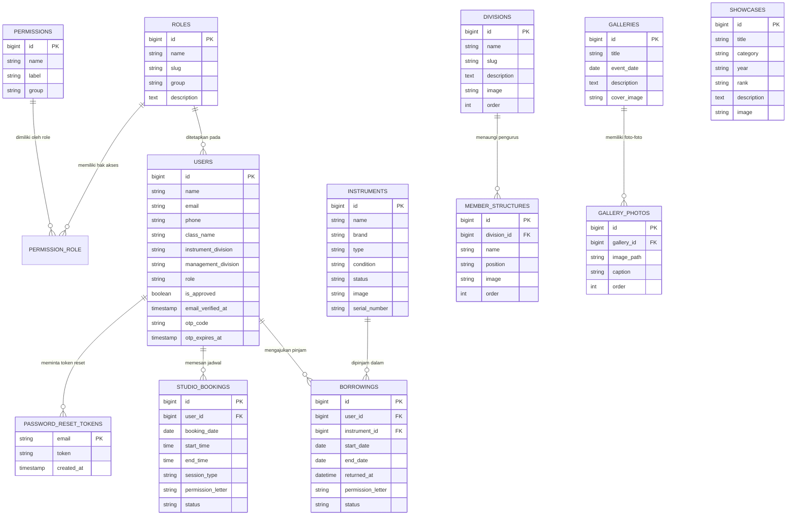

### Kamus Data Ringkas (12 Tabel Sistem):
| Tabel | Kegunaan & Relasi |
| :--- | :--- |
| `users` | Akun siswa dan pengurus, data kelas, no WA, divisi musik, status verifikasi OTP Gmail, dan role. |
| `roles` | Master peran kepengurusan (Ketua, Wakil, Sekretaris, Bendahara, Perkap, PDD, Alat Musik, Anggota). |
| `permissions` | Katalog hak akses perizinan granular modul (`view_`, `create_`, `edit_`, `delete_`, `approve_`). |
| `permission_role` | Tabel pivot relasi *Many-to-Many* antara role dan izin akses. |
| `instruments` | Inventaris alat musik (merk, tipe, kondisi fisik, status ketersediaan, serial number, foto). |
| `borrowings` | Transaksi peminjaman alat, rentang tanggal pinjam/kembali, surat izin bertanda tangan, dan status. |
| `studio_bookings` | Transaksi reservasi Studio STM, tanggal, jam mulai/selesai, surat izin, dan status persetujuan. |
| `divisions` | Master data 6 divisi kepengurusan organisasi Smecone Music. |
| `member_structures` | Personalia kepengurusan pada masing-masing divisi (nama, jabatan, urutan, foto). |
| `galleries` | Album dokumentasi acara/kegiatan ekskul. |
| `gallery_photos` | Koleksi multi-foto dalam setiap album galeri dokumentasi kegiatan. |
| `showcases` | Koleksi piala kejuaraan dan portofolio prestasi musik SMKN 1 Purwokerto. |

---

## 📸 Dokumentasi Visual Aplikasi (Per Halaman Lengkap)

Berikut adalah tangkapan layar beresolusi tinggi untuk setiap halaman antarmuka sistem:

### A. Area Publik & Branding Sekolah

#### 1. Landing Page Utama (`/`)
*Halaman depan publik dengan hero banner bertema musik, kutipan filosofis ekskul, kartu peminatan instrumen, piala prestasi kejuaraan FLS3N, agenda konser Student Act Festival, serta jadwal rutin Studio STM.*
<p align="center">
  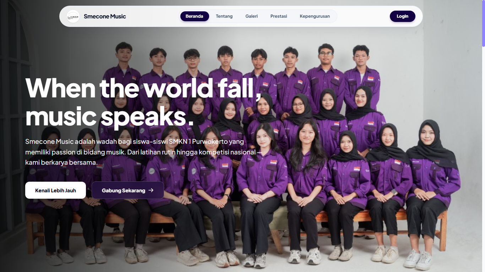
</p>

#### 2. Halaman Tentang Kami (`/about`)
*Profil sejarah perjalanan Smecone Music di SMKN 1 Purwokerto, Visi, Misi, serta 4 Pilar Karakter pembinaan bermusik.*
<p align="center">
  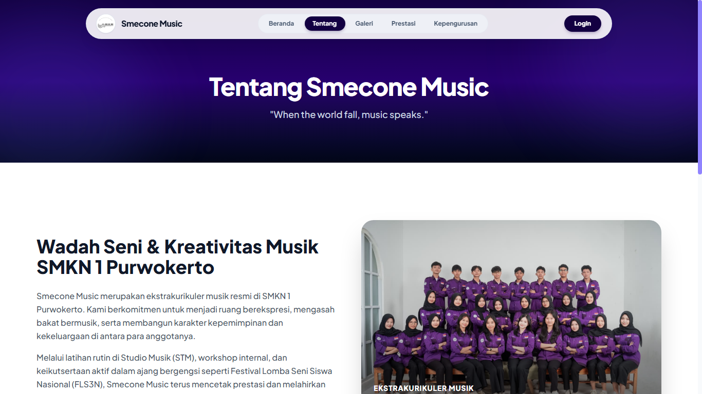
</p>

#### 3. Halaman Galeri Dokumentasi Kegiatan (`/gallery`)
*Arsip album foto dokumentasi kegiatan konser, latihan gabungan, dan workshop sound engineering dengan fitur interaktif Lightbox Viewer.*
<p align="center">
  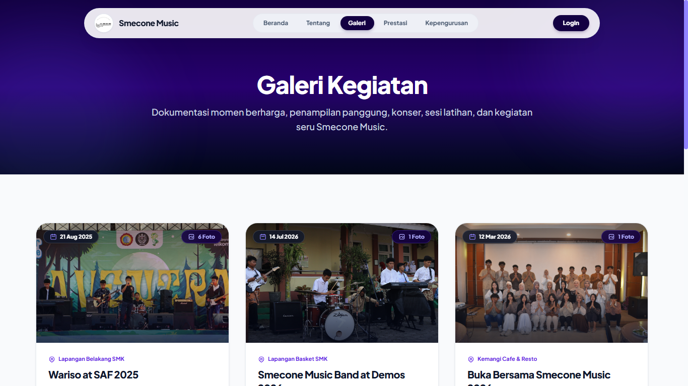
</p>

#### 4. Halaman Portofolio Prestasi (`/showcase`)
*Etalase rekam jejak trofi kejuaraan festival musik pelajar dan lomba FLS3N tingkat kabupaten hingga provinsi.*
<p align="center">
  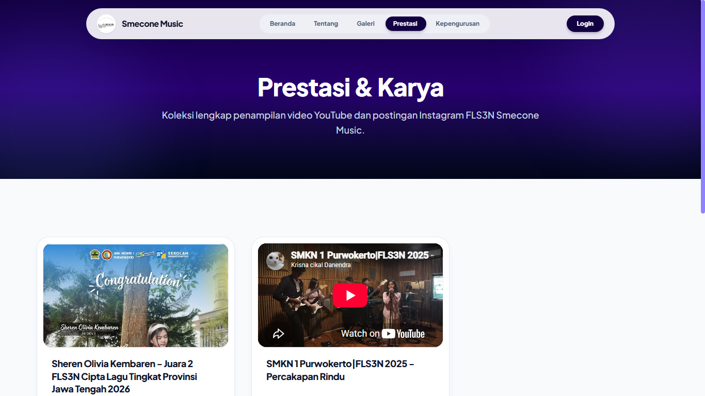
</p>

#### 5. Halaman Struktur Organisasi (`/struktur`)
*Bagan hierarki personalia kepengurusan Smecone Music dari Pengurus Inti hingga seluruh divisi bidang teknis.*
<p align="center">
  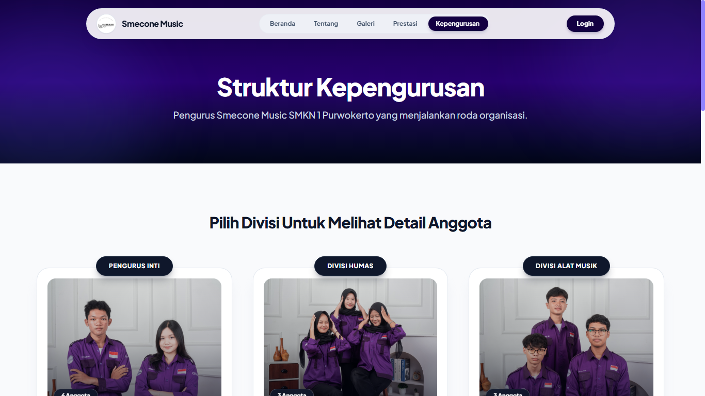
</p>

---

### B. Autentikasi, Keamanan, & OTP

| Halaman Login (`/login`) | Halaman Registrasi Siswa (`/register`) | Halaman Lupa Password (`/forgot-password`) |
| :---: | :---: | :---: |
| 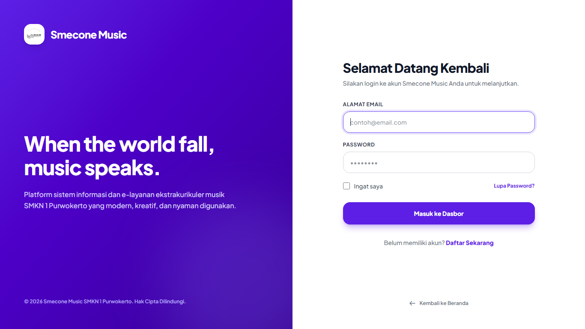 | 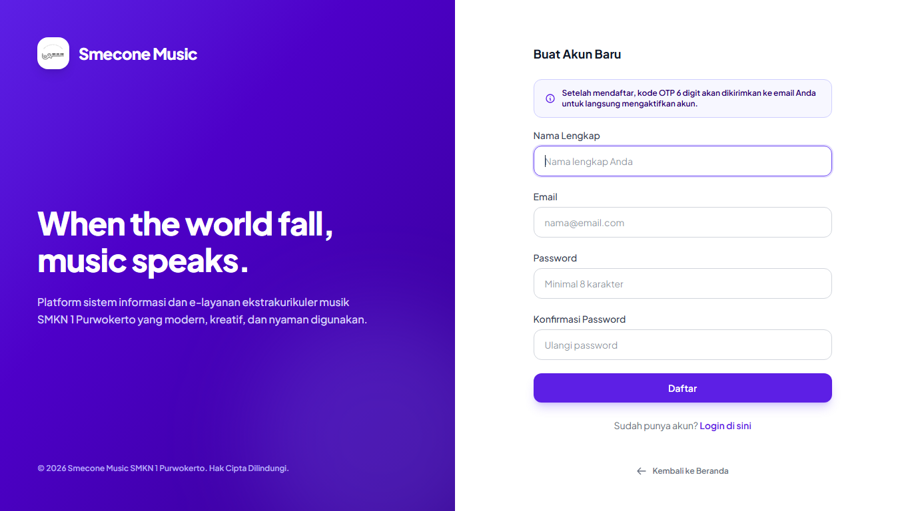 | 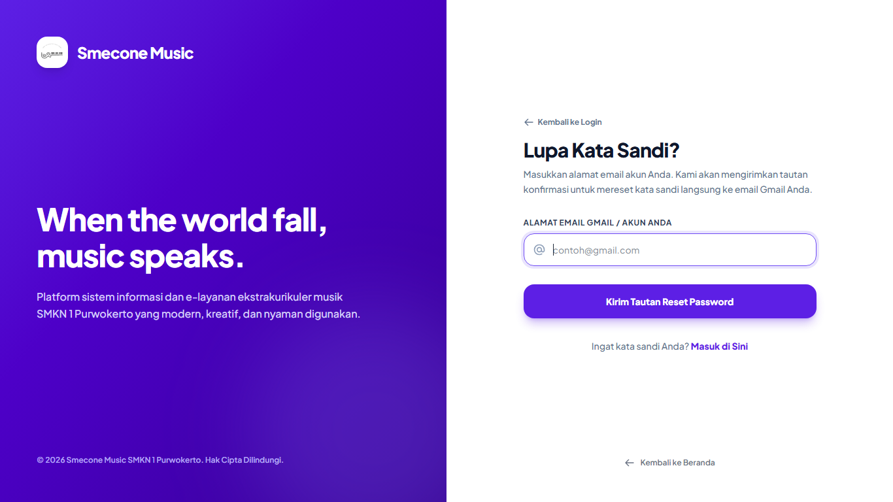 |
| *Proteksi CSRF, bcrypt, & Remember Me* | *Registrasi mandiri terintegrasi OTP Google SMTP Gmail* | *Reset kata sandi aman via tautan email resmi* |

---

### C. Area Siswa / Anggota (User Dashboard)

#### 1. Dashboard Siswa (`/dashboard`)
*Tampilan beranda personal siswa menampilkan ringkasan status pinjam alat aktif dan jadwal latihan studio mendatang.*
<p align="center">
  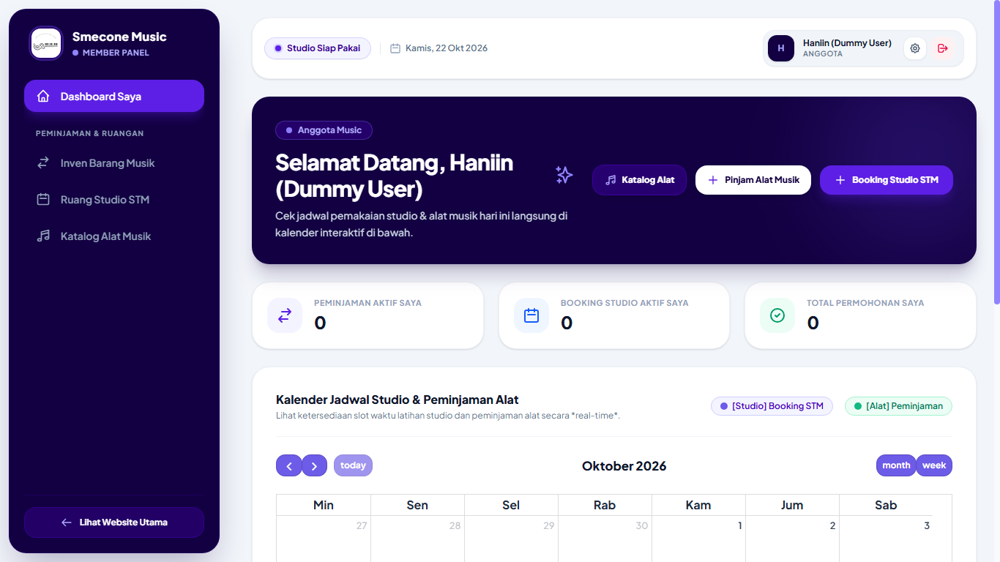
</p>

#### 2. Modal Pengaturan Profil Siswa & Ganti Password (Navbar)
*Modal pengaturan mandiri anggota: pembaruan Nama Lengkap, Nomor WhatsApp, Kelas (contoh: XII PPLG 2), Divisi Musik (Alat Musik / Vokal), dan ganti kata sandi terverifikasi sandi lama.*
<p align="center">
  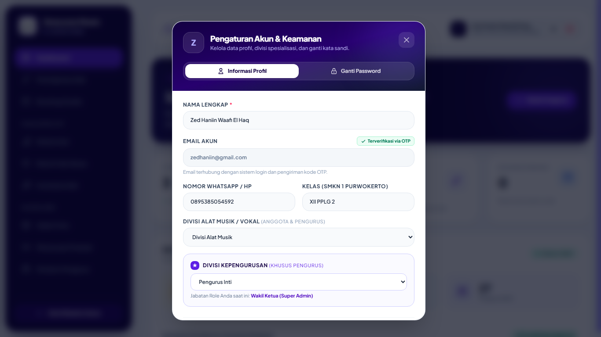
</p>

#### 3. Katalog Inventaris Alat Musik (`/dashboard/instruments`)
*Katalog alat musik sekolah yang berstatus tersedia untuk dipinjam siswa lengkap dengan foto alat, merk, dan kondisi fisik.*
<p align="center">
  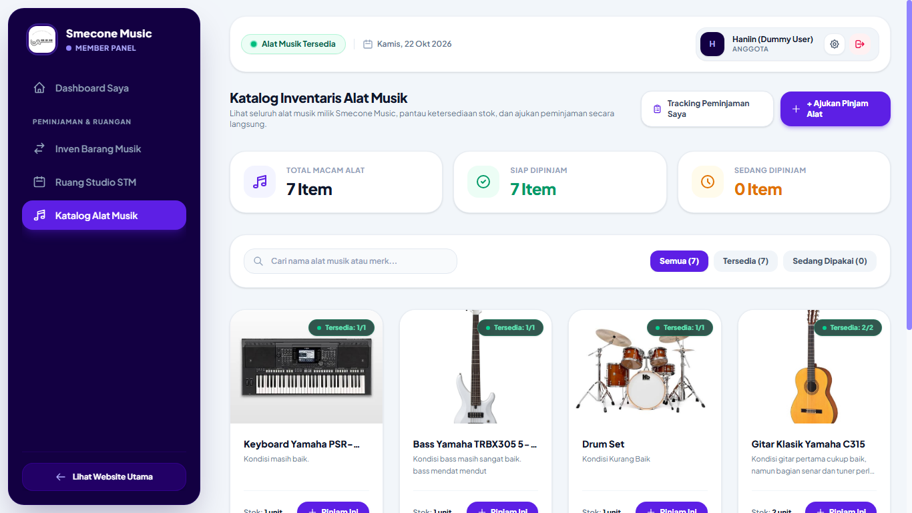
</p>

#### 4. Form Pengajuan Peminjaman Alat & Riwayat Siswa (`/dashboard/borrowing/create` & `/dashboard/borrowings`)
*Formulir pengajuan peminjaman instrumen dengan kewajiban unggah surat izin bertanda tangan serta tabel pelacakan status realtime.*
<p align="center">
  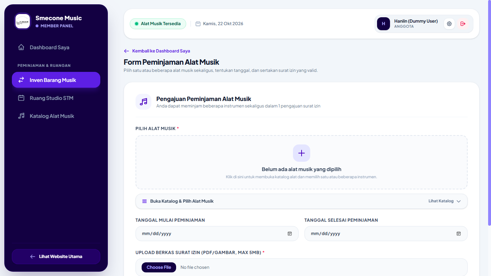
  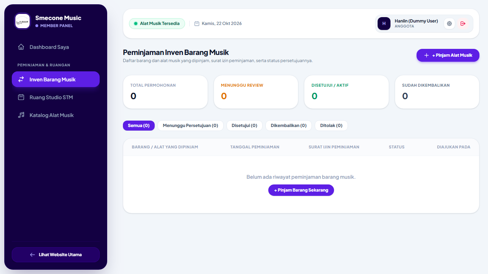
</p>

#### 5. Form Reservasi Studio STM & Riwayat Booking Siswa (`/dashboard/booking/create` & `/dashboard/bookings`)
*Pemesanan jam latihan Studio STM dengan validasi anti-bentrok jadwal otomatis di level server, wajib unggah surat izin, dan tabel tracking riwayat pemesanan.*
<p align="center">
  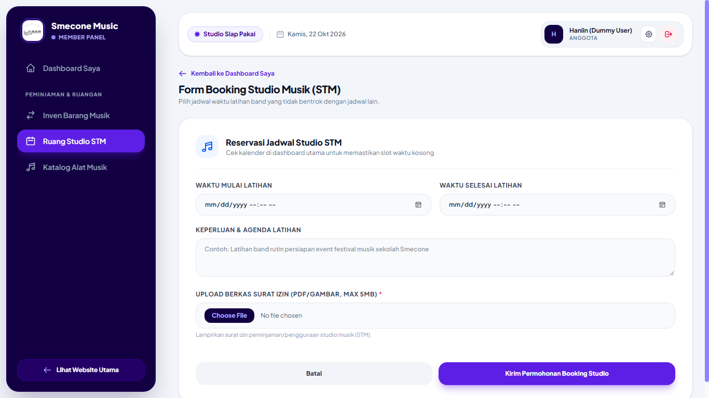
  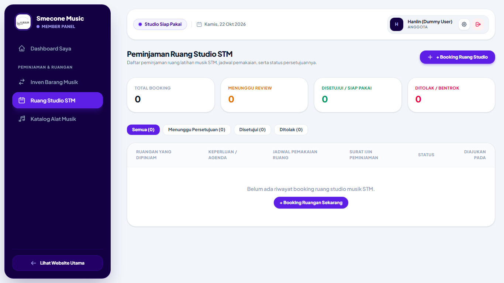
</p>

#### 6. Kalender Jadwal Latihan Studio STM (`/dashboard/calendar`)
*Visualisasi kalender interaktif untuk memeriksa ketersediaan jam latihan Studio STM dan jadwal sesi yang sudah terisi.*
<p align="center">
  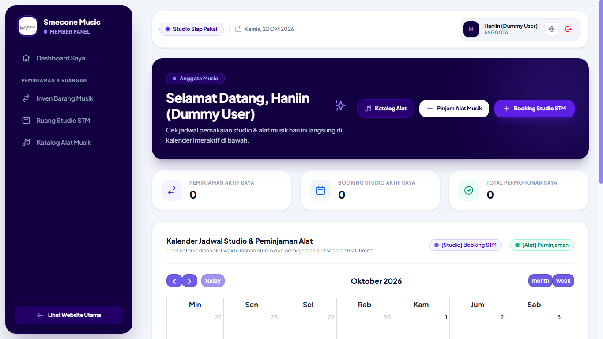
</p>

---

### D. Area Panel Administrator & Pengurus

#### 1. Dashboard Administrator & Pengurus (`/admin`)
*Ringkasan metrik statistik operasional: total inventaris instrumen, peminjaman aktif, pemesanan studio hari ini, dan jumlah akun siswa terdaftar.*
<p align="center">
  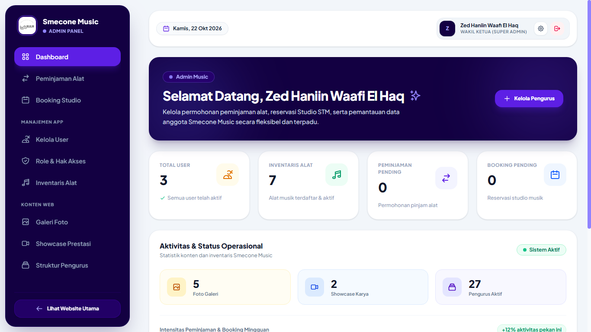
</p>

#### 2. Manajemen Akun Pengguna & Sub-Badge Identitas (`/admin/users`)
*Tabel manajemen akun pengguna dengan sub-badge langsung di bawah nama: **Kelas / Jurusan** dan **Pilihan Divisi Musik**, status verifikasi OTP Gmail, serta tombol aksi Detail verifikasi.*
<p align="center">
  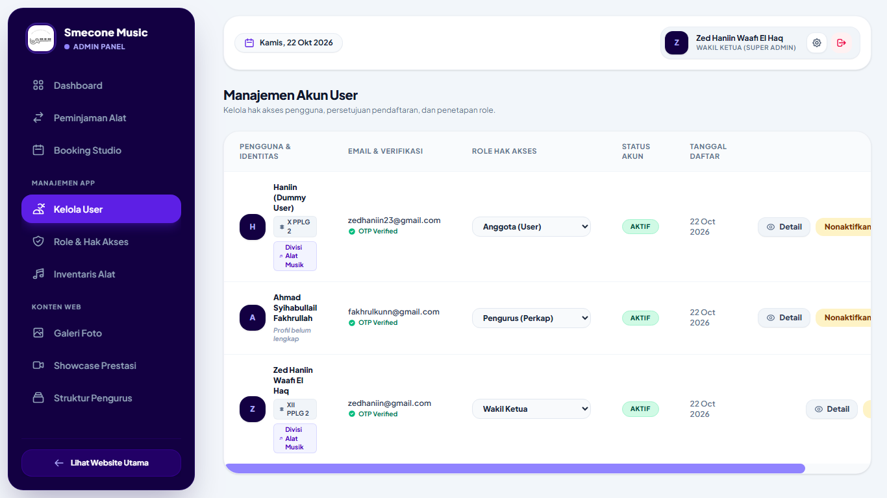
</p>

#### 3. Modal Detail Verifikasi Siswa SMKN 1 & Tombol Chat WhatsApp
*Modal popup verifikasi untuk mendata keabsahan siswa aktif SMKN 1 Purwokerto dan anggota musik, dilengkapi **Tombol Chat WhatsApp** langsung ke nomor siswa.*
<p align="center">
  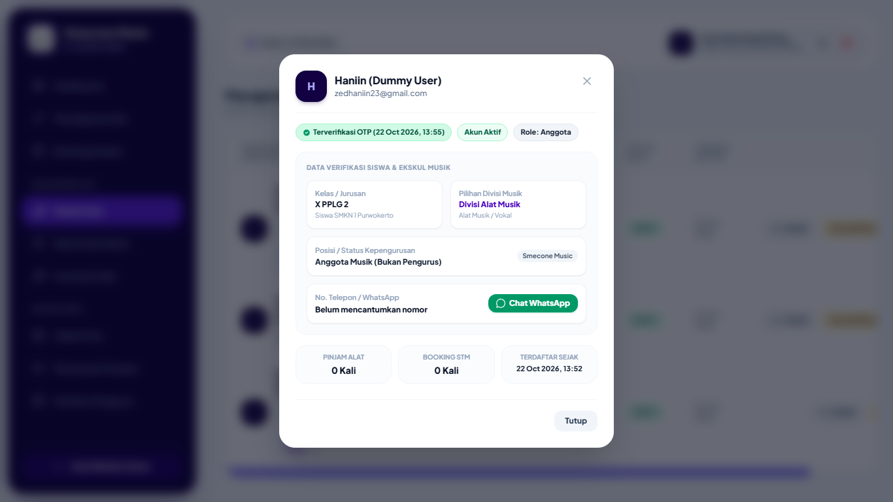
</p>

#### 4. Manajemen Peran & Hak Akses Pengurus (`/admin/roles`)
*Default navigasi tab role langsung aktif ke **Ketua (Super Admin)** dengan penjelasan hak akses permanen sistem.*
<p align="center">
  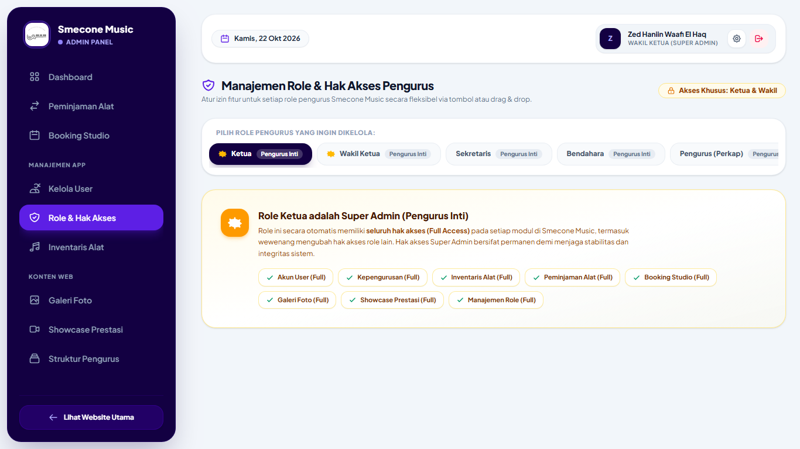
</p>

#### 5. Matriks Perizinan Akses Interaktif Drag & Drop (`/admin/roles?role=sekretaris`)
*Dual-box interaktif (Katalog Izin Tersedia vs Izin Aktif Role) yang mendukung interaksi **Drag & Drop** HTML5, tombol assign cepat, search filter, dan preset tombol **Set View-Only**.*
<p align="center">
  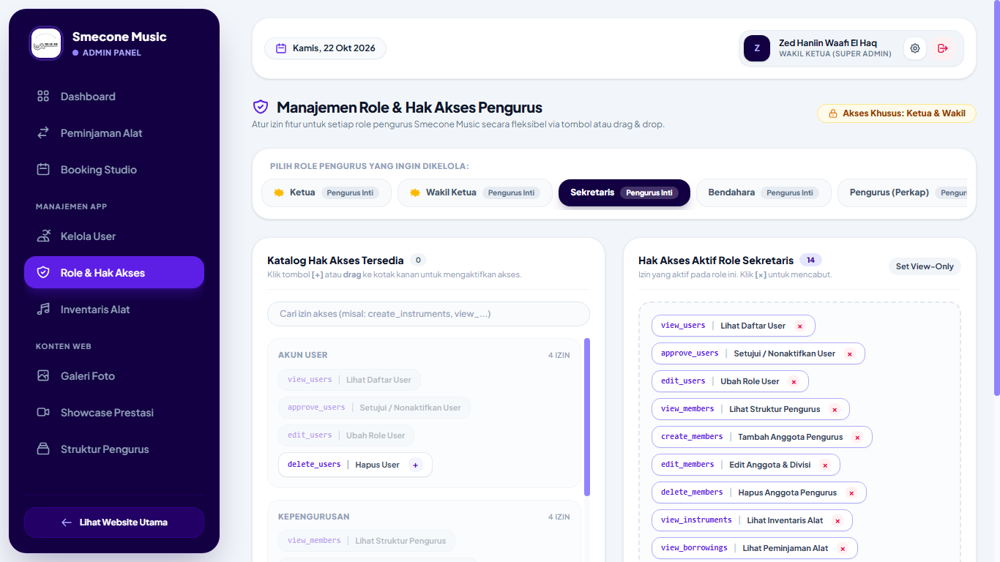
</p>

#### 6. Manajemen Master Inventaris Alat Musik (`/admin/instruments`)
*Katalog master alat musik inventaris sekolah: pemantauan kondisi fisik (Baik, Rusak Ringan, Perbaikan), status ketersediaan, serial number, dan foto alat.*
<p align="center">
  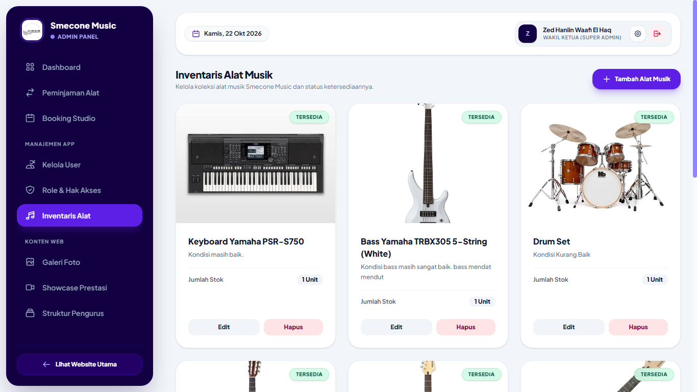
</p>

#### 7. Persetujuan Transaksi & Layanan Operasional
| Persetujuan Pinjam Alat (`/admin/borrowings`) | Persetujuan Booking Studio (`/admin/bookings`) |
| :---: | :---: |
| 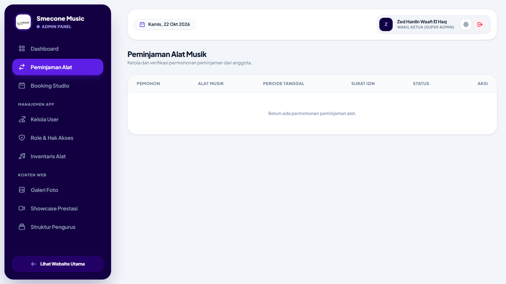 | 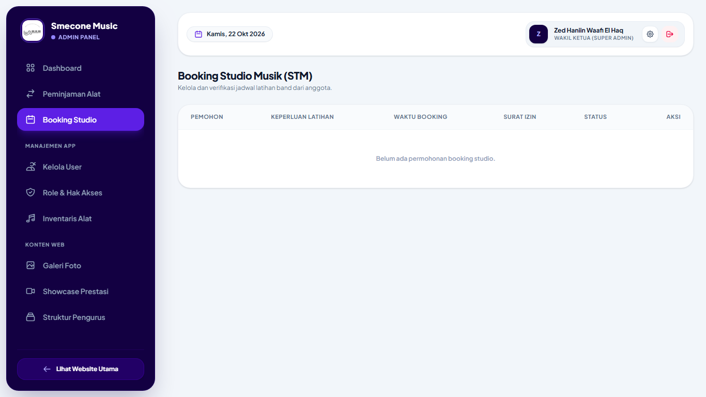 |
| *Verifikasi surat izin peminjaman alat & pencatatan pengembalian fisik instrumen* | *Verifikasi berkas surat izin studio & persetujuan slot jadwal latihan STM* |

#### 8. Modul CMS Konten Publik Ekskul
| Personalia Pengurus (`/admin/members`) | Galeri Dokumentasi (`/admin/galleries`) | Trofi Prestasi (`/admin/showcases`) |
| :---: | :---: | :---: |
| 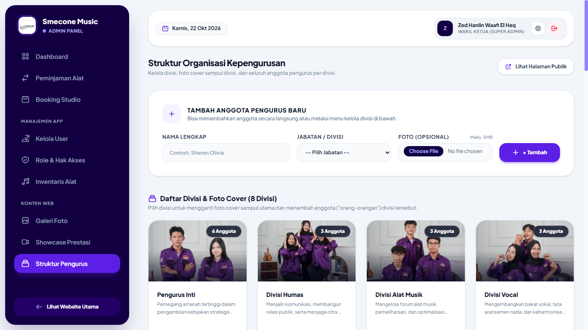 | 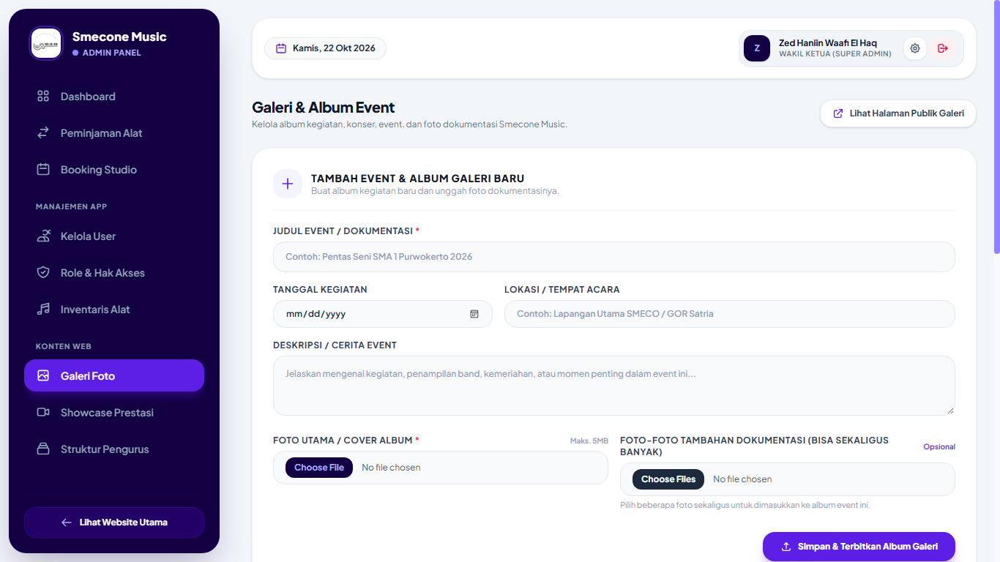 | 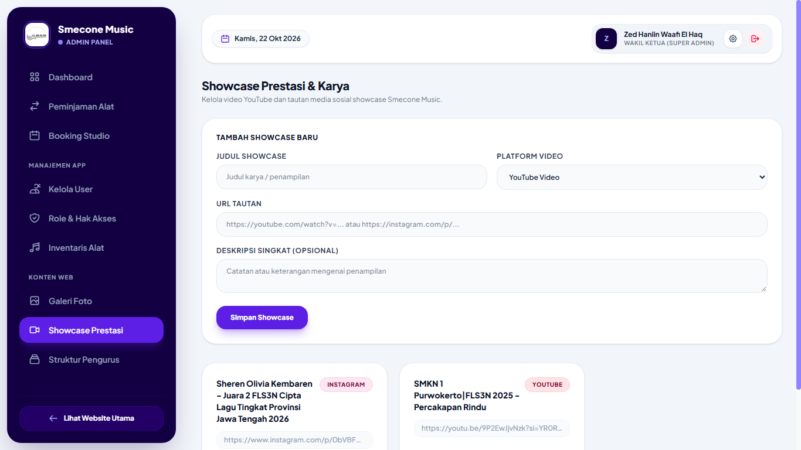 |
| *Kelola struktur divisi & personalia pengurus* | *Kelola album dokumentasi multi-foto kegiatan* | *Kelola daftar piala & rekam jejak juara* |

---

## 🛡️ Role-Based Access Control (RBAC) & Matriks Hak Akses

Sistem menerapkan hierarki hak akses berjenjang yang aman dan fleksibel:

| Role Pengguna | Level Otoritas | Cakupan Hak Akses Utama |
| :--- | :--- | :--- |
| **Ketua & Wakil Ketua** | Super Admin | Akses mutlak (*Full Access*) ke seluruh modul sistem, persetujuan transaksi, inventaris, manajemen user, serta hak mengatur matriks izin role lain. |
| **Sekretaris & Bendahara** | Pengurus Inti | Kelola struktur organisasi, verifikasi akun anggota, verifikasi/approval peminjaman alat & booking studio STM. |
| **Pengurus Divisi Perkap** | Seksi Inventaris | Kelola master inventaris alat musik, verifikasi permohonan pinjam alat, dan pencatatan pengembalian fisik barang (*returned*). |
| **Pengurus Divisi PDD** | Publikasi & Dok | Kelola album galeri dokumentasi foto kegiatan dan portofolio prestasi piala kejuaraan. |
| **Pengurus Divisi Alat Musik** | Seksi Musik | Monitoring kondisi alat musik inventaris dan verifikasi peminjaman instrumen. |
| **Pengurus Divisi Lain** | View-Only | Akses tinjau (*View-Only*) ke seluruh panel operasional tanpa wewenang mengubah data master. |
| **Anggota Siswa (User)** | Member | Mengajukan pinjam alat, booking studio STM, tracking status transaksi, dan kelola profil mandiri. |

---

## 🧪 Pengujian Kualitas Perangkat Lunak (Automated QA 100% Pass)

Aplikasi telah diuji menggunakan framework automated testing **PHPUnit / Laravel Feature Tests** dengan hasil **100% PASS**:

```
PASS  Tests\Feature\OtpRegistrationAndStudioLetterTest
  ✓ registration requires otp verification before access
  ✓ valid otp verifies user successfully
  ✓ resend otp generates fresh code
  ✓ studio booking requires permission letter upload
  ✓ instrument borrowing requires permission letter upload

PASS  Tests\Feature\PasswordResetTest
  ✓ forgot password page can be rendered
  ✓ password reset link can be requested
  ✓ reset password screen can be rendered with valid token
  ✓ password can be reset with valid token
  ✓ password cannot be reset with invalid token
  ✓ expired reset tokens are rejected

PASS  Tests\Feature\ProfileSettingsTest
  ✓ profile settings page can be rendered
  ✓ user can update their name class phone and division
  ✓ user can change password with correct current password
  ✓ user cannot change password with incorrect current password
  ✓ validation rejects non matching password confirmation
  ✓ instrument division dropdown only allows valid options

PASS  Tests\Feature\RoleAndPermissionTest
  ✓ ketua as super admin can access roles management
  ✓ non super admin cannot access roles management
  ✓ super admin can update role permissions
  ✓ super admin cannot demote or strip ketua permissions
  ✓ secretary role has appropriate permissions
  ✓ perkap role has inventory permissions
  ✓ user role cannot access admin panel

PASS  Tests\Feature\StudioBookingTest
  ✓ user can create studio booking
  ✓ overlapping studio booking is rejected (anti-bentrok jadwal)
  ✓ admin can approve studio booking
  ✓ admin can reject studio booking

PASS  Tests\Feature\GalleryAndBorrowingTest
PASS  Tests\Feature\MemberStructureTest

Tests:    44 passed (174 assertions)
Duration: 1.88s
Status:   100% PASS
```

---

## 🚀 Panduan Instalasi & Menjalankan Proyek

### Persyaratan Sistem:
* PHP >= 8.2 (Direkomendasikan PHP 8.3)
* Composer 2.x
* MySQL >= 8.0 (Tersedia via Laragon / XAMPP)
* Node.js >= 18.x & NPM

### Langkah-Langkah:

1. **Clone Repository**:
   ```bash
   git clone https://github.com/zedhaniin/Website---Smecone-Music.git
   cd Website---Smecone-Music
   ```

2. **Install Dependensi Backend & Frontend**:
   ```bash
   composer install
   npm install
   ```

3. **Konfigurasi Berkas Environment (`.env`)**:
   Salin `.env.example` menjadi `.env`:
   ```bash
   cp .env.example .env
   php artisan key:generate
   ```
   Pastikan konfigurasi database di file `.env` sudah sesuai:
   ```env
   DB_CONNECTION=mysql
   DB_HOST=127.0.0.1
   DB_PORT=3306
   DB_DATABASE=smecone_music
   DB_USERNAME=root
   DB_PASSWORD=
   ```

4. **Migrasi Database & Seeder Data Awal**:
   * **Opsi A (Menggunakan Migration & Seeder Laravel)**:
     ```bash
     php artisan migrate --seed
     ```
   * **Opsi B (Import file SQL yang telah disediakan)**:
     Import berkas `database/smecone_music.sql` ke database MySQL `smecone_music` melalui phpMyAdmin / HeidiSQL.

5. **Buat Symlink Penyimpanan Media**:
   ```bash
   php artisan storage:link
   ```

6. **Kompilasi Aset Frontend**:
   ```bash
   npm run build
   ```

7. **Jalankan Aplikasi Web**:
   ```bash
   php artisan serve
   ```
   Buka browser dan akses: `http://localhost:8000`

---

## 🔑 Kredensial Akun Default Demo

| Role | Email | Password | Hak Akses |
| :--- | :--- | :--- | :--- |
| **Ketua (Super Admin)** | `admin@smecone.music` | `password` | Super Admin Penuh |
| **Wakil Ketua** | `zedhaniin@gmail.com` | `password` | Super Admin Penuh |
| **Sekretaris** | `sekretaris@smecone.music` | `password` | Pengurus Inti |
| **Bendahara** | `bendahara@smecone.music` | `password` | Pengurus Inti |
| **Pengurus Perkap** | `fakhrulkunn@gmail.com` | `password` | Seksi Inventaris |
| **Anggota Siswa (User)** | `user@smecone.music` | `password` | Anggota Terdaftar |

---

<p align="center">
  Dibuat dengan dedikasi untuk kemajuan ekstrakurikuler seni musik<br>
  <strong>SMK Negeri 1 Purwokerto</strong> © 2026
</p>
