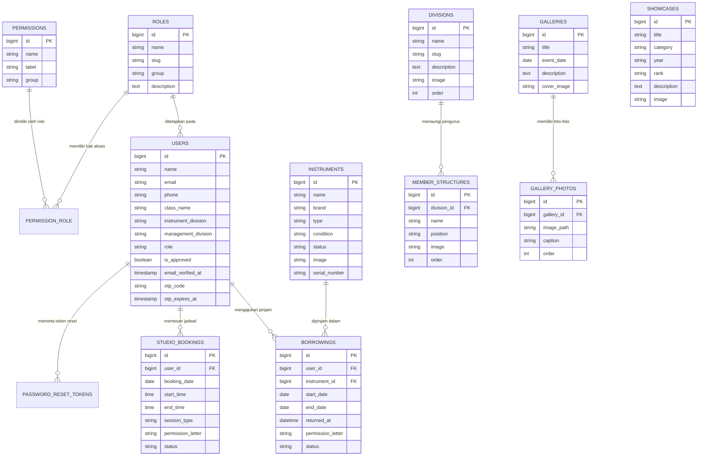

# 🎵 SMECONE MUSIC — Sistem Informasi & Manajemen Ekstrakurikuler

<p align="center">
  
</p>

<p align="center">
  <strong>Ekstrakurikuler Musik SMK Negeri 1 Purwokerto</strong><br>
  <em>"When the world falls, music speaks."</em>
</p>

<p align="center">
  
  
  
  
  
  
</p>

---

## 📌 Daftar Isi
1. [Tentang Proyek](#-tentang-proyek)
2. [Latar Belakang & Tujuan](#-latar-belakang--tujuan)
3. [Arsitektur & Skema Basis Data](#-arsitektur--skema-basis-data)
4. [Daftar Fitur & Tampilan Antarmuka](#-daftar-fitur--tampilan-antarmuka)
   - [A. Area Publik](#a-area-publik)
   - [B. Autentikasi & Keamanan Akun](#b-autentikasi--keamanan-akun)
   - [C. Area Siswa / Anggota (User Dashboard)](#c-area-siswa--anggota-user-dashboard)
   - [D. Area Panel Administrator & Pengurus](#d-area-panel-administrator--pengurus)
5. [Role & Matriks Hak Akses (RBAC)](#-role--matriks-hak-akses-rbac)
6. [Hasil Pengujian Kualitas (Testing & QA)](#-hasil-pengujian-kualitas-testing--qa)
7. [Panduan Instalasi & Menjalankan](#-panduan-instalasi--menjalankan)
8. [Akun Default Demo](#-akun-default-demo)

---

## 📖 Tentang Proyek
**Smecone Music Web Application** adalah platform digital berbasis web yang dirancang khusus untuk memfasilitasi tata kelola operasional, peminjaman aset alat musik, reservasi Studio Musik (STM), serta publikasi portofolio ekstrakurikuler musik di **SMK Negeri 1 Purwokerto**. 

Aplikasi ini mengintegrasikan antarmuka publik yang estetis dan modern bernuansa *dark-mode* musik dengan sistem informasi manajemen internal berjenjang berbasis peran (*Role-Based Access Control*).

---

## 🎯 Latar Belakang & Tujuan

### Latar Belakang
Sebelum sistem ini dikembangkan, operasional Smecone Music menghadapi beberapa kendala nyata:
1. **Pencatatan Peminjaman Alat Masih Konvensional**: Peminjaman alat musik inventaris sekolah dicatat di buku tulis atau chat WhatsApp, sehingga riwayat peminjaman rawan tercecer dan kondisi fisik alat sulit dipantau seksi Perlengkapan (Perkap).
2. **Bentrok Jadwal Studio Musik (STM)**: Sering terjadi benturan jadwal latihan antar grup band atau sesi vokal karena tidak adanya kalender ketersediaan studio terpusat.
3. **Ketiadaan Sistem Verifikasi Identitas Siswa**: Pengurus kesulitan memastikan apakah peminjam fasilitas benar-benar siswa aktif SMKN 1 Purwokerto dan anggota musik terdaftar.
4. **Keterbatasan Media Promosi Resmi**: Siswa dan pihak luar kesulitan mengakses informasi resmi mengenai struktur kepengurusan, dokumentasi kegiatan, dan prestasi kejuaraan FLS3N / festival musik.

### Tujuan Utama
* **Digitalisasi Tata Kelola**: Mentransformasikan birokrasi peminjaman inventaris dan reservasi studio dari manual menjadi digital yang transparan dan akuntabel.
* **Tertib Birokrasi Sekolah**: Penerapan wajib unggah surat permohonan izin untuk peminjaman alat maupun pemesanan Studio STM.
* **Sentralisasi Data & Verifikasi Anggota**: Mempermudah pendataan kelas, nomor kontak WhatsApp, dan divisi musik anggota.
* **Showcase Prestasi & Branding**: Menyajikan etalase resmi kebanggaan sekolah untuk menampilkan galeri kegiatan interaktif dan koleksi trofi prestasi.

---

## 🗄️ Arsitektur & Skema Basis Data

Sistem didukung oleh **MySQL Relational Database** dengan 12 tabel utama yang ternormalisasi:



### Ringkasan Tabel Database:
| Nama Tabel | Deskripsi & Kegunaan |
| :--- | :--- |
| `users` | Menyimpan data akun siswa/pengurus, kelas, no WA, divisi musik, status verifikasi OTP, dan role. |
| `roles` | Menyimpan master data role kepengurusan (Ketua, Wakil, Sekretaris, Bendahara, Perkap, PDD, Alat Musik, Anggota). |
| `permissions` | Katalog perizinan granular fitur (`view_`, `create_`, `edit_`, `delete_`, `approve_`). |
| `permission_role` | Tabel pivot relasi Many-to-Many antara role dan hak akses. |
| `instruments` | Katalog inventaris alat musik (merk, kondisi fisik, status ketersediaan, serial number, foto). |
| `borrowings` | Transaksi peminjaman alat, batas waktu kembali, berkas surat izin, dan status persetujuan. |
| `studio_bookings` | Transaksi reservasi Studio STM, tanggal, jam mulai/selesai, surat izin, dan validasi bentrok. |
| `divisions` | Master data 6 divisi kepengurusan (Pengurus Inti, Alat Musik, Vocal, Kegiatan, PDD, Perkap, Humas, Wirausaha). |
| `member_structures` | Personalia struktur organisasi pengurus pada masing-masing divisi. |
| `galleries` | Album dokumentasi acara/kegiatan ekskul. |
| `gallery_photos` | Koleksi multi-foto dalam satu album kegiatan. |
| `showcases` | Koleksi piala kejuaraan dan portofolio prestasi musik SMKN 1 Purwokerto. |
| `password_reset_tokens` | Token keamanan reset kata sandi melalui tautan email Gmail. |

---

## 🖥️ Daftar Fitur & Tampilan Antarmuka

### A. Area Publik
1. **Landing Page Utama (`/`)**:
   - Header hero dinamis dengan tombol aksi cepat (*Jelajahi Divisi* & *Ajukan Pinjaman*).
   - Profil filosofi & slogan ekskul (*"When the world falls, music speaks."*).
   - Preview kartu divisi instrumen musik interaktif.
   - Showcase piala prestasi pilihan & preview galeri kegiatan dengan *lightbox modal*.
   - Footer informatif 3-kolom dengan tautan media sosial dan alamat SMKN 1 Purwokerto.
2. **Halaman Tentang Kami (`/about`)**:
   - Sejarah terbentuknya Smecone Music, Visi, Misi, dan 4 Pilar Organisasi.
3. **Halaman Galeri Dokumentasi (`/gallery`)**:
   - Album dokumentasi foto kegiatan ekskul dengan fitur *Lightbox Viewer* responsif.
4. **Halaman Portofolio Prestasi (`/showcase`)**:
   - Etalase rekam jejak juara FLS3N tingkat kabupaten/provinsi dan festival musik pelajar.
5. **Halaman Struktur Organisasi (`/struktur`)**:
   - Tampilan hierarki seluruh divisi kepengurusan beserta foto, nama, dan jabatan personalia.

---

### B. Autentikasi & Keamanan Akun
1. **Registrasi Mandiri Siswa dengan OTP Gmail (`/register`)**:
   - Siswa dapat mendaftar mandiri secara instan tanpa antre manual.
   - Sistem mengirimkan kode verifikasi 6-digit secara realtime via **Google SMTP Gmail**.
   - Halaman verifikasi OTP dilengkapi timer mundur 5 menit, tombol kirim ulang kode, dan auto-focus digit.
2. **Sistem Login & Proteksi (`/login`)**:
   - Login aman dengan proteksi CSRF dan enkripsi *bcrypt*.
   - Fitur *Remember Me* untuk menyimpan sesi pengguna.
3. **Lupa Password Terintegrasi Email (`/forgot-password`)**:
   - Form permohonan reset password dengan validasi email terdaftar.
   - Pengiriman tautan reset ke Gmail dengan template surat resmi bernuansa Smecone Music.
   - Tombol langsung *"Buka Gmail Sekarang"* untuk mempermudah pengguna.
   - Halaman pembuatan kata sandi baru (`/reset-password`) dengan verifikasi token kedaluwarsa.

---

### C. Area Siswa / Anggota (User Dashboard)
1. **Dashboard Anggota (`/dashboard`)**:
   - Ringkasan peminjaman aktif dan jadwal latihan studio mendatang.
2. **Form Peminjaman Alat Musik (`/peminjaman/create`)**:
   - Pemilihan alat musik yang berstatus tersedia.
   - Input tanggal pinjam dan rencana tanggal pengembalian.
   - **Wajib Unggah Surat Izin**: Unggah berkas surat permohonan pinjam (PDF/JPG/PNG) bertanda tangan.
3. **Reservasi Jadwal Studio STM (`/booking/create`)**:
   - Pemilihan tanggal, jam mulai, dan jam selesai latihan.
   - **Kalender Bebas Bentrok**: Sistem secara otomatis mengecek ketersediaan jam latihan; jika jadwal bertabrakan dengan band lain, sistem akan menolak dan memberi peringatan.
   - **Wajib Unggah Surat Izin Studio**: Unggah surat izin kegiatan studio.
4. **Pelacakan Status Pengajuan (`/peminjaman`, `/booking`)**:
   - Riwayat pengajuan dengan badge status realtime (*Menunggu Persetujuan, Disetujui, Ditolak, Sudah Dikembalikan*).
5. **Pengaturan Akun & Profil Mandiri (Navbar Modal)**:
   - Ganti Nama Lengkap.
   - Ganti Password dengan verifikasi password lama & toggle lihat sandi.
   - Pengisian **Kelas / Jurusan** (contoh: *XII PPLG 2*).
   - Pengisian **Nomor WhatsApp / Telepon**.
   - Pemilihan **Divisi Musik** (*Divisi Alat Musik* atau *Divisi Vokal*).
   - Status Kepengurusan (*Pengurus* atau *Anggota Reguler*).

---

### D. Area Panel Administrator & Pengurus
1. **Dashboard Statistik Admin (`/admin`)**:
   - Metrik total inventaris alat musik, total peminjaman aktif, booking studio hari ini, dan jumlah akun siswa.
2. **Manajemen Akun User (`/admin/users`)**:
   - Tabel pengguna dengan sub-badge langsung di bawah nama: **Kelas** dan **Divisi Musik**.
   - Indikator status verifikasi OTP Gmail (*Verified* / *Pending*).
   - **Tombol "Detail" Identitas Siswa**:
     - Menampilkan popup modal profil lengkap siswa.
     - Memverifikasi keabsahan anak sekolah SMKN 1 Purwokerto dan anggota musik.
     - **Tombol Langsung "Chat WhatsApp"**: Membuka tautan direct WhatsApp (`wa.me/...`) untuk memudahkan pengurus mengonfirmasi langsung ke siswa.
     - Statistik rekam jejak jumlah pinjam alat dan booking studio.
   - Tombol cepat *Setujui / Nonaktifkan* akun dan *Hapus User*.
   - Dropdown pengubahan role pengguna secara instan.
3. **Manajemen Role & Hak Akses Dinamis (`/admin/roles`)**:
   - Tab navigasi role pengurus (default langsung aktif ke **Ketua**).
   - **Dual Box Interaktif**: Kotak Katalog Izin Tersedia (kiri) vs Kotak Izin Aktif (kanan).
   - Fitur **Drag & Drop** izin akses antar kotak.
   - Tombol cepat **[+] Tambah** dan **[x] Cabut**.
   - Tombol preset cepat **"Set View-Only"** untuk pengurus non-inti.
   - Filter pencarian izin instan dan indikator jumlah izin aktif.
   - Perlindungan sistem: Role Ketua & Wakil Ketua (Super Admin) memiliki izin permanen penuh dan tidak dapat dicabut.
4. **Persetujuan Peminjaman Alat (`/admin/borrowings`)**:
   - Tinjauan surat izin yang diunggah siswa peminjam.
   - Tombol Setujui / Tolak peminjaman.
   - Tombol pencatatan pengembalian fisik alat (*Returned*) saat alat diserahkan kembali ke seksi Perkap.
5. **Persetujuan Reservasi Studio STM (`/admin/bookings`)**:
   - Verifikasi jadwal dan surat pengajuan studio.
   - Approval & Rejection reservasi studio.
6. **Master Data Alat Musik (`/admin/instruments`)**:
   - Tambah, edit, dan hapus katalog instrumen inventaris sekolah.
   - Pengaturan merk, nomor seri, kondisi (Baik, Rusak Ringan, Perbaikan), dan status ketersediaan.
7. **Content Management System (CMS Publik)**:
   - **Kelola Struktur Pengurus (`/admin/members`)**: Tambah/edit pengurus divisi, jabatan, dan foto.
   - **Kelola Galeri Acara (`/admin/galleries`)**: Tambah album kegiatan dan multi-upload foto.
   - **Kelola Showcase Prestasi (`/admin/showcases`)**: Dokumentasi piala, tahun perolehan, dan peringkat lomba.

---

## 🛡️ Role & Matriks Hak Akses (RBAC)

| Role Pengurus / Akun | Tingkat Akses | Hak Akses Utama |
| :--- | :--- | :--- |
| **Ketua & Wakil Ketua** | Super Admin | Akses penuh (*Full Access*) ke seluruh modul sistem, persetujuan transaksi, inventaris, akun, dan wewenang mutlak mengatur izin role lain. |
| **Sekretaris & Bendahara** | Pengurus Inti | Kelola struktur kepengurusan, kelola akun anggota, verifikasi/approval peminjaman alat & reservasi studio. |
| **Pengurus Divisi Perkap** | Pengurus | Kelola master inventaris alat musik, verifikasi peminjaman alat, dan pencatatan pengembalian fisik instrumen. |
| **Pengurus Divisi PDD** | Pengurus | Kelola galeri dokumentasi foto kegiatan dan kelola showcase portofolio prestasi. |
| **Pengurus Divisi Alat Musik** | Pengurus | Monitoring inventaris alat musik dan verifikasi peminjaman instrumen. |
| **Pengurus Divisi Lain** | View-Only | Memiliki akses tinjau (*View-Only*) ke seluruh panel informasi operasional tanpa wewenang mengubah data. |
| **Anggota Siswa (User)** | Member | Mengajukan pinjam alat, booking studio STM, tracking status, dan kelola profil mandiri. |

---

## 🧪 Hasil Pengujian Kualitas (Testing & QA)

Aplikasi telah diuji menggunakan framework automated testing **PHPUnit / Laravel Feature Tests**:

```
PASS  Tests\Feature\OtpRegistrationAndStudioLetterTest
  ✓ registration requires otp verification before access
  ✓ valid otp verifies user successfully
  ✓ resend otp generates fresh code
  ✓ studio booking requires permission letter upload
  ✓ instrument borrowing requires permission letter upload

PASS  Tests\Feature\PasswordResetTest
  ✓ forgot password page can be rendered
  ✓ password reset link can be requested
  ✓ reset password screen can be rendered with valid token
  ✓ password can be reset with valid token
  ✓ password cannot be reset with invalid token
  ✓ expired reset tokens are rejected

PASS  Tests\Feature\ProfileSettingsTest
  ✓ profile settings page can be rendered
  ✓ user can update their name class phone and division
  ✓ user can change password with correct current password
  ✓ user cannot change password with incorrect current password
  ✓ validation rejects non matching password confirmation
  ✓ instrument division dropdown only allows valid options

PASS  Tests\Feature\RoleAndPermissionTest
  ✓ ketua as super admin can access roles management
  ✓ non super admin cannot access roles management
  ✓ super admin can update role permissions
  ✓ super admin cannot demote or strip ketua permissions
  ✓ secretary role has appropriate permissions
  ✓ perkap role has inventory permissions
  ✓ user role cannot access admin panel

PASS  Tests\Feature\StudioBookingTest
  ✓ user can create studio booking
  ✓ overlapping studio booking is rejected
  ✓ admin can approve studio booking
  ✓ admin can reject studio booking

PASS  Tests\Feature\GalleryAndBorrowingTest
PASS  Tests\Feature\MemberStructureTest

Tests:    44 passed (174 assertions)
Duration: 1.88s
Status:   100% PASS
```

---

## 🚀 Panduan Instalasi & Menjalankan

### Persyaratan Sistem:
* PHP >= 8.2 (Disarankan PHP 8.3)
* Composer 2.x
* MySQL >= 8.0 (Tersedia via Laragon / XAMPP)
* Node.js >= 18.x & NPM

### Langkah-Langkah:

1. **Clone Repository**:
   ```bash
   git clone https://github.com/zedhaniin/Website---Smecone-Music.git
   cd Website---Smecone-Music
   ```

2. **Install Dependensi Backend & Frontend**:
   ```bash
   composer install
   npm install
   ```

3. **Konfigurasi Berkas Environment (`.env`)**:
   Salin `.env.example` menjadi `.env`:
   ```bash
   cp .env.example .env
   php artisan key:generate
   ```
   Pastikan konfigurasi database di file `.env` sudah sesuai:
   ```env
   DB_CONNECTION=mysql
   DB_HOST=127.0.0.1
   DB_PORT=3306
   DB_DATABASE=smecone_music
   DB_USERNAME=root
   DB_PASSWORD=
   ```

4. **Migrasi Database & Seeder Data Awal**:
   * Opsi A (Menggunakan Migration & Seeder Laravel):
     ```bash
     php artisan migrate --seed
     ```
   * Opsi B (Import file SQL yang telah disediakan):
     Import berkas `database/smecone_music.sql` ke database MySQL `smecone_music` melalui phpMyAdmin / HeidiSQL.

5. **Buat Symlink Penyimpanan Media**:
   ```bash
   php artisan storage:link
   ```

6. **Kompilasi Aset Frontend**:
   ```bash
   npm run build
   ```

7. **Jalankan Aplikasi Web**:
   ```bash
   php artisan serve
   ```
   Buka browser dan akses: `http://localhost:8000`

---

## 🔑 Akun Default Demo

| Role | Email | Password | Hak Akses |
| :--- | :--- | :--- | :--- |
| **Ketua (Super Admin)** | `admin@smecone.music` | `password` | Super Admin Penuh |
| **Wakil Ketua** | `zedhaniin@gmail.com` | `password` | Super Admin Penuh |
| **Sekretaris** | `sekretaris@smecone.music` | `password` | Pengurus Inti |
| **Bendahara** | `bendahara@smecone.music` | `password` | Pengurus Inti |
| **Pengurus Perkap** | `fakhrulkunn@gmail.com` | `password` | Seksi Inventaris |
| **Anggota Siswa (User)** | `user@smecone.music` | `password` | Anggota Terdaftar |

---

<p align="center">
  Dibuat dengan dedikasi untuk kemajuan ekstrakurikuler seni musik<br>
  <strong>SMK Negeri 1 Purwokerto</strong> © 2026
</p>
